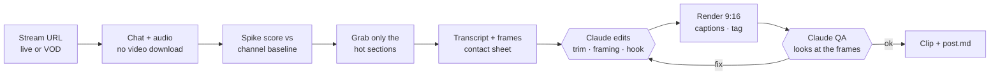

<p align="center">
  
</p>

<h1 align="center">Ortha Clipper</h1>

<p align="center">
  <b>AI stream clipper for GTA 6 (GTA VI), Twitch and YouTube streams, with Claude Code as your editor.</b><br>
  Paste a stream link and get captioned 9:16 clips for TikTok, YouTube Shorts and Instagram Reels.<br>
  No API keys. It runs on the Claude subscription you already have.
</p>

<p align="center">
  <a href="#install">Install</a> ·
  <a href="#clip-gta-vi-streams">GTA VI</a> ·
  <a href="#how-it-works">How it works</a> ·
  <a href="#the-dashboard">Dashboard</a> ·
  <a href="#faq">FAQ</a>
</p>

---

Ortha Clipper is a free, open-source **auto clipper for live streams and VODs**. It finds the moments where a streamer's chat lost it, cuts them, frames the facecam and the gameplay, burns in word-by-word captions and a hook, adds your clipper tag, and checks every render before you post it.

Most AI clippers send a transcript to a language model and hope. Ortha Clipper splits the job the way a real editing team would:

- **The script measures.** It downloads, reads chat, measures loudness, transcribes and renders, all locally. This part is deterministic and fast.
- **Claude edits.** It reads what chat was screaming, picks the moments worth posting, trims from setup to payoff, writes the hook, finds the facecam in an actual frame, follows whoever is talking, then looks at the rendered result and re-cuts it if something is off.

## Clip GTA VI streams

GTA 6 is the biggest thing on Twitch and YouTube right now, and the clippers who post first get the views. Ortha Clipper is tuned for it:

- **Knows the game.** It reads GTA VI (and GTA V, Fortnite, Valorant, CS2, Warzone, Minecraft, Marvel Rivals and more) from the stream title. Hooks name the play ("1 VS 3", "HE GOT WASTED"), titles name the game, and posts carry the hashtags people actually search for: `#GTA6 #GTAVI #GTA6Game #ViceCity #RockstarGames`.
- **Facecam + gameplay layout.** Facecam on top, Vice City below, in proper 9:16, with the HUD and overlay borders cropped out.
- **Remembers each streamer.** Frame a GTA streamer's facecam once and every later stream from that channel opens already framed.
- **Live, while the stream is on.** Watch a GTA 6 stream live and get a saved clip within seconds of chat going off, ahead of the people clipping the VOD tomorrow.

## What it does

| | |
|---|---|
| **Chat-spike detection, per channel** | Chat activity is scored against *that channel's own* trailing baseline and counted in **distinct chatters**, so one spammer or an emote wave doesn't count as a hype moment. Audio loudness and hype words add to the score. |
| **Live and VOD** | `live` keeps a rolling 4-minute buffer and saves a moment the instant chat spikes. `scan` handles a finished stream or a local recording. |
| **Downloads only what it needs** | The scan grabs chat and the smallest audio track (about 20 MB per hour). Video is downloaded only for the moments you keep. A 1-hour VOD scans in about a minute. |
| **Speaker-aware framing** | Facecam + gameplay, crop-to-fill, whole frame on blur, or **timed shots** that cut to whoever is talking (great for duo cams and panels). |
| **Word-by-word captions** | The active word is highlighted, timed from faster-whisper word timestamps, and drawn as image overlays, so they work with any ffmpeg build. |
| **Your brand on every clip** | Your clipper handle goes on every render. Streamer credit goes in the post copy. |
| **Ready to post** | 1080×1920 H.264, loudness at -14 LUFS, `+faststart` for iOS, plus a `post.md` with a title, TikTok/Reels caption, hashtags and a Shorts description. |
| **Token-friendly** | The main session scans and delegates. A Sonnet `clip-editor` subagent edits each clip in parallel, and Opus only steps in when a clip needs a second look. |

## Install

Requires [Claude Code](https://claude.com/claude-code) and [uv](https://docs.astral.sh/uv/). ffmpeg is recommended; a bundled one is used if it's missing.

```
/plugin install ortha-clipper --marketplace connectfazla/ortha-clipper
```

On older Claude Code versions:

```
/plugin marketplace add connectfazla/ortha-clipper
/plugin install ortha-clipper@ortha-clipper
```

Then just ask Claude:

> clip the best GTA 6 moments from https://www.twitch.tv/videos/...
>
> watch twitch.tv/somestreamer live and clip whenever chat goes off
>
> make 5 shorts from this YouTube stream https://www.youtube.com/watch?v=...

The first run asks for your clipper handle (for example `@yourclips`) and installs its Python dependencies automatically.

## The dashboard

Every command opens a local dashboard at **http://localhost:8790**. You can drive everything from there:

- **Paste a link** and choose *Find moments* (no AI tokens), *Auto-clip with Claude* (Haiku, Sonnet or Opus), or *Watch live*.
- **Chat timeline** against the channel's normal, with every spike marked.
- **Moments table:** what chat said, how many people reacted, and one-click **Grab**.
- **Clip editor:** trim with the player or by clicking transcript lines, **draw the facecam and gameplay boxes** on a real frame, choose the layout, place the hook and captions, set your tag, render, or hand the clip to Claude with notes.
- **Activity:** live progress, running jobs, and a Stop button.

It only listens on `127.0.0.1` and checks a per-session token on every action, so other websites can't start jobs on your machine.

## How it works



| Source | VOD chat | Live chat |
|---|---|---|
| YouTube | chat replay via yt-dlp | live chat via yt-dlp |
| Twitch | audio only, or `--chat` with a [TwitchDownloader](https://github.com/lay295/TwitchDownloader) export | anonymous IRC |
| Kick / local file | audio only | n/a |

## Command line

Claude runs these for you, but you can run them yourself too:

```bash
C="uv run --script skills/clip/clipper.py"
$C config clipper "@yourclips"                 # your tag on every clip
$C scan  <url|file> [--chat chat.json]         # find moments
$C grab  <url|file> 1:02:10 1:02:55            # download + transcribe one section
$C render clips/<src>/m3730 --in 4 --out 38 \
     --cam 0.73,0.04,0.25,0.26 --hook "he got wasted" --remember
$C live  <url>                                 # clip a live stream as it happens
$C frames clips/<src>/m3730 12 14.5 20         # check exact moments
```

Run the self-check with `uv run --script tests/test_clipper.py`.

## FAQ

**How do I clip GTA 6 streams automatically?**
Install the plugin and ask Claude to clip a GTA VI stream or VOD link. It detects the game, finds the spikes, frames facecam + gameplay, captions the clip, and tags it `#GTA6`.

**Do I need an OpenAI, Gemini or Anthropic API key?**
No. Claude Code does the editing on your existing Claude subscription. Transcription runs locally with faster-whisper.

**Does it work with Twitch, YouTube and Kick?**
Yes, for VODs. Live clipping works on Twitch and YouTube. Twitch VOD chat needs a TwitchDownloader export, since Twitch offers no public chat-replay API.

**Can it clip a live stream before it ends?**
Yes. `live` mode saves each moment about 15 seconds after chat spikes, with a desktop notification.

**Will it work on podcasts, Just Chatting or IRL streams?**
Yes. Timed shots follow whoever is talking, and the spike detector works on any stream with an active chat.

**Is it free?**
Yes, MIT licensed. The editing uses your Claude Code plan.

## Credits

Ideas borrowed with thanks from [PeakCut](https://github.com/haziqahmedqasmi/peakcut) (game-aware copy, counting chatters instead of messages, per-creator profiles), [TwitchSnipBot](https://github.com/bihanikeshav/TwitchSnipBot) (z-score chat spikes), [vod-to-viral](https://github.com/LuisSotelo/vod-to-viral) (score chat + audio first, download only the hot segments), and [AI-Youtube-Shorts-Generator](https://github.com/Anil-matcha/AI-Youtube-Shorts-Generator) (a score and hook for each clip).

## Responsible clipping

Clip other people's streams only with their permission or through a clipping program they run, and always credit the streamer.

*Ortha Clipper is not affiliated with or endorsed by Rockstar Games, Take-Two Interactive, Twitch, YouTube or Kick. Grand Theft Auto and GTA are trademarks of Take-Two Interactive.*

MIT © [connectfazla](https://github.com/connectfazla) · Built by [Ortha Studio](https://ortha.studio)
