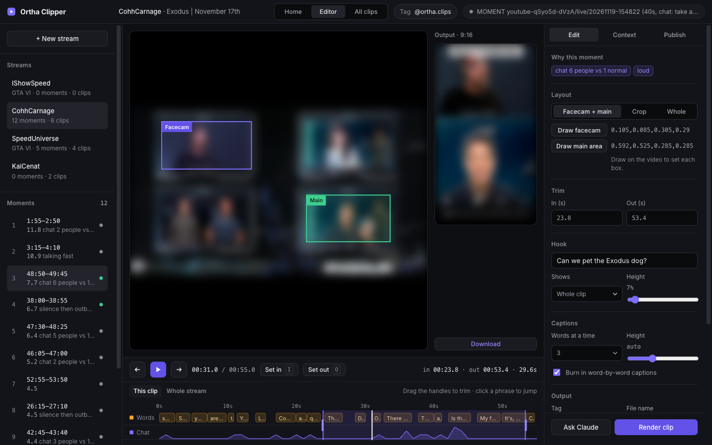
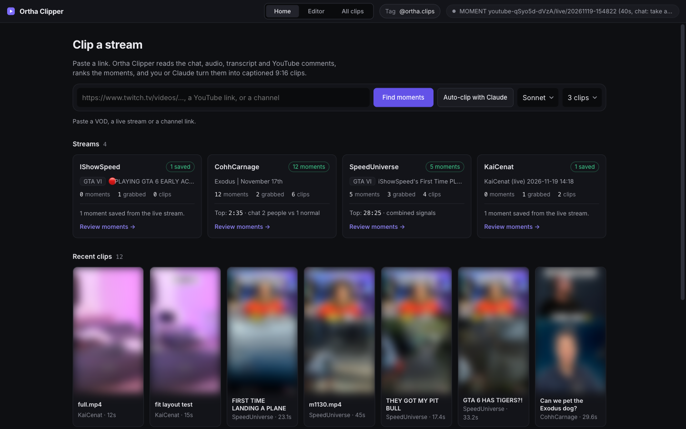
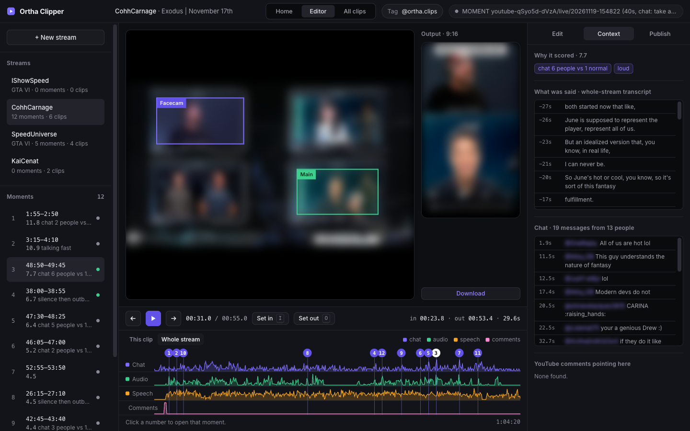
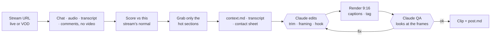

<p align="center">
  
</p>

<h1 align="center">Ortha Clipper: AI GTA 6 &amp; Twitch Stream Clipper for Claude Code</h1>

<p align="center">
  <b>Turn Twitch, YouTube and Kick streams (live or VOD) into captioned 9:16 clips for TikTok, YouTube Shorts and Instagram Reels.</b><br>
  It finds the moments from chat, audio, the transcript and YouTube comments, and Claude Code edits every clip.<br>
  An open-source Opus Clip alternative for stream clippers. No API keys: it runs on your Claude subscription.
</p>

<p align="center">
  <a href="LICENSE"></a>
  
  
  
</p>

<p align="center">
  <a href="#install">Install</a> ·
  <a href="#clip-gta-vi-streams">GTA VI</a> ·
  <a href="#how-it-picks-moments">How it picks moments</a> ·
  <a href="#the-dashboard">Dashboard</a> ·
  <a href="#token-use">Token use</a> ·
  <a href="#faq">FAQ</a>
</p>

<p align="center">
  
</p>

---

Ortha Clipper is a free, open-source **AI stream clipper** that runs inside [Claude Code](https://claude.com/claude-code). Paste a stream link. It finds the moments that hit, cuts them, frames the facecam and gameplay, burns in word-by-word captions and a hook, adds **your** clipper tag, and checks every render before you post it.

Most AI clippers send a transcript to a language model and hope. Ortha Clipper works like an editing team:

- **The script measures.** It downloads, reads chat, measures loudness, transcribes and renders, all locally. This part is deterministic and fast.
- **Claude edits.** Before cutting, it reads why each moment scored, what was said around it, what chat wrote and what commenters remembered. It picks the moments worth posting, trims from setup to payoff, writes the hook, frames the shot from a real frame, follows whoever is talking, then looks at the rendered result and re-cuts it if something is off.

## Clip GTA VI streams

GTA 6 is the biggest thing on Twitch and YouTube right now, and the clippers who post first get the views.

- **Knows the game.** It reads GTA VI (also GTA V, Fortnite, Valorant, CS2, Warzone, Minecraft, Marvel Rivals and more) from the stream title. Hooks name the play ("1 VS 3", "HE GOT WASTED"), titles name the game, and posts carry the hashtags people search for: `#GTA6 #GTAVI #GTA6Game #ViceCity #RockstarGames`.
- **Facecam + gameplay layout.** Facecam on top, Vice City below, in proper 9:16, with the HUD and overlay borders cropped out.
- **Remembers each streamer.** Frame a GTA streamer's facecam once and every later stream from that channel opens already framed.
- **Clips live.** Watch a GTA 6 stream live and get a saved clip seconds after chat goes off, ahead of the people clipping the VOD tomorrow.

## How it picks moments

Each 5-second slice of the stream is scored against **that stream's own normal**. The signals are independent and capped, so no single one decides:

| Signal | What it catches |
|---|---|
| **Chat** | Distinct people reacting (not messages, so one spammer can't fake a spike), plus hype words like `KEKW`, `W` and `?????` |
| **Audio** | Loudness spikes, and the *silence-then-outburst* shape of a real reaction |
| **Transcript** | A free local Whisper pass over the whole stream: "no way", "oh my god", "clip it", fast excited speech |
| **YouTube comments** | Timestamps viewers wrote ("2:13:40 LMAO"), weighted by likes |

Every moment shows **why** it scored and **what was said**. Claude also reads a compact skim of the whole transcript to catch the stories, hot takes and setups that chat stayed quiet for, then applies the **3-second test** working clippers use: would a stranger get it within 3 seconds?

Before any clip is cut, Ortha Clipper writes a `context.md` for that moment: the surrounding transcript, the chat in that window, and the comments pointing at it. The editor reads it first.

## What it does

| | |
|---|---|
| **Live and VOD** | `live` keeps a rolling 4-minute buffer and saves a moment the instant chat spikes (Twitch IRC, YouTube live chat). `scan` covers a finished stream or a local recording. |
| **Downloads only what it needs** | Chat plus the smallest *original-language* audio track (about 20 MB per hour; YouTube's AI-dubbed tracks are skipped). Video is downloaded only for the moments you keep. Long scans resume if interrupted. |
| **Speaker-aware framing** | Facecam + gameplay, crop-to-fill, whole frame on blur, or **timed shots** that cut to whoever is talking (duo cams, panels, podcasts). |
| **Word-by-word captions** | The active word is highlighted, timed from Whisper word timestamps, and proofread by Claude for names and slang. Captions are drawn as image overlays, so they work with any ffmpeg build. |
| **Your brand** | Your clipper handle goes on every clip. Streamer credit goes in the post copy. |
| **Ready to post** | 1080×1920 H.264, loudness at -14 LUFS, `+faststart` for iOS, plus a `post.md` with a title, TikTok/Reels caption, hashtags and a Shorts description. |
| **Multi-agent** | One Sonnet `clip-editor` subagent per clip, in parallel. Opus steps in only for clips that need a second look. |

## The dashboard

Every command opens a local dashboard at **http://localhost:8790**.

<p align="center">
  
</p>

- **Home:** paste a link and press *Find moments* (no AI tokens) or *Auto-clip with Claude* (Haiku, Sonnet or Opus). A link that's live right now gets watched live automatically. Running jobs show their latest step and a Stop button, each stream card says what's happening and what to do next, and recent clips open in one click. Your tag is in the header, and clicking *Ortha Clipper* always brings you back Home.
- **Editor:** a pro editing layout.
  - The 16:9 source with **framing boxes you draw on the video**, next to a live 9:16 output preview.
  - A transport bar, and a timeline with transcript and chat tracks and drag-to-trim handles. Keys: `Space` plays, `I`/`O` set in and out.
  - A whole-stream view with chat, audio, speech and comment tracks and every moment marked.
- **Inspector:**
  - **Edit:** why the moment scored, then layout, trim, hook, captions and tag. *Ask Claude* and *Render clip* stay pinned at the bottom.
  - **Context:** why the moment scored, the transcript before and after it, the chat in that window, and the comments.
  - **Publish:** QA frames, post copy and versions.
- **All clips:** every render in one grid.

<p align="center">
  
</p>

The dashboard only listens on `127.0.0.1` and checks a per-session token on every action, so other websites can't start jobs on your machine.

<sub>Screenshots show public VODs analyzed locally. Video frames and chat usernames are blurred.</sub>

## Install

Requires [Claude Code](https://claude.com/claude-code) and [uv](https://docs.astral.sh/uv/). ffmpeg is recommended; a bundled one is used if it's missing.

```
/plugin install ortha-clipper --marketplace connectfazla/ortha-clipper
```

On older Claude Code versions:

```
/plugin marketplace add connectfazla/ortha-clipper
/plugin install ortha-clipper@ortha-clipper
```

Then just ask Claude:

> clip the best GTA 6 moments from https://www.twitch.tv/videos/...
>
> watch twitch.tv/somestreamer live and clip whenever chat goes off
>
> make 5 shorts from this YouTube stream https://www.youtube.com/watch?v=...

The first run asks for your clipper handle (for example `@yourclips`) and installs its Python dependencies automatically.

## Token use

Measured on real runs, one clip each:

| Part | Model | Input tokens | Output tokens |
|---|---|---|---|
| Main session: scan, analyse, pick, delegate | Haiku or Sonnet | ~400k raw, ~75k after caching | ~6k |
| Clip editor, per clip | Sonnet | 60–140k raw, 16–32k after caching | 2–3.5k |

Dashboard runs start Claude without your other MCP servers and plugins: **19.5k instead of 39.6k context tokens per turn**. The scan itself (chat, audio, transcript, comments) uses no AI tokens.

## How it works



| Source | VOD chat | Live chat |
|---|---|---|
| YouTube | chat replay via yt-dlp | live chat via yt-dlp |
| Twitch | audio, transcript, or `--chat` with a [TwitchDownloader](https://github.com/lay295/TwitchDownloader) export | anonymous IRC |
| Kick / local file | audio and transcript | n/a |

## Command line

Claude runs these for you, but you can run them yourself too:

```bash
C="uv run --script skills/clip/clipper.py"
$C config clipper "@yourclips"                 # your tag on every clip
$C scan  <url|file> [--chat chat.json]         # find moments (chat, audio, transcript, comments)
$C grab  <url|file> --moments 1,3,5            # grab several picks at once
$C render clips/<src>/m3730 --in 4 --out 38 \
     --cam 0.73,0.04,0.25,0.26 --hook "he got wasted" --remember
$C live  <url>                                 # clip a live stream as it happens
$C frames clips/<src>/m3730 12 14.5 20         # check exact moments
```

Run the self-check with `uv run --script tests/test_clipper.py`.

## FAQ

**How do I clip GTA 6 streams automatically?**
Install the plugin and ask Claude to clip a GTA VI stream or VOD link, or paste it into the dashboard and choose *Auto-clip with Claude*. It detects the game, finds the moments, frames facecam + gameplay, captions the clip, and tags it `#GTA6`.

**How does it decide what's worth clipping?**
Chat, audio, the streamer's own words and viewers' comment timestamps are each scored against that stream's normal, and none of them decides alone. Claude then reads the context around each candidate, and skims the whole stream for anything the signals missed.

**Is it an Opus Clip alternative?**
Yes, built for streams. Opus Clip and similar tools pick moments from the transcript. Ortha Clipper adds chat, audio and comment signals, live clipping, facecam + gameplay framing and per-streamer profiles, and it runs locally for free.

**Do I need an OpenAI, Gemini or Anthropic API key?**
No. Claude Code does the editing on your existing Claude subscription. Transcription runs locally with faster-whisper.

**Does it work with Twitch, YouTube and Kick?**
Yes, for VODs. Live clipping works on Twitch and YouTube. Twitch VOD chat needs a TwitchDownloader export, since Twitch offers no public chat-replay API.

**Can it clip a live stream before it ends?**
Yes. `live` mode saves each moment about 15 seconds after chat spikes, with a desktop notification.

**Will it work on podcasts, Just Chatting or IRL streams?**
Yes. Timed shots follow whoever is talking, and the transcript signals work even without chat.

**Is it free?**
Yes, MIT licensed. The editing uses your Claude Code plan.

## Credits

Ideas borrowed with thanks from [PeakCut](https://github.com/haziqahmedqasmi/peakcut) (game-aware copy, counting chatters instead of messages, per-creator profiles), [TwitchSnipBot](https://github.com/bihanikeshav/TwitchSnipBot) (z-score chat spikes), [vod-to-viral](https://github.com/LuisSotelo/vod-to-viral) (score chat and audio first, download only the hot segments), and [AI-Youtube-Shorts-Generator](https://github.com/Anil-matcha/AI-Youtube-Shorts-Generator) (a score and hook for each clip). The moment criteria follow published clipper playbooks from AutoClip, CLIPPING, Clyper and LazyClipper.

## Responsible clipping

Clip other people's streams only with their permission or through a clipping program they run, and always credit the streamer.

*Ortha Clipper is not affiliated with or endorsed by Rockstar Games, Take-Two Interactive, Twitch, YouTube, Kick or Opus Clip. Grand Theft Auto and GTA are trademarks of Take-Two Interactive.*

MIT © [connectfazla](https://github.com/connectfazla) · Built by [Ortha Studio](https://ortha.studio)
